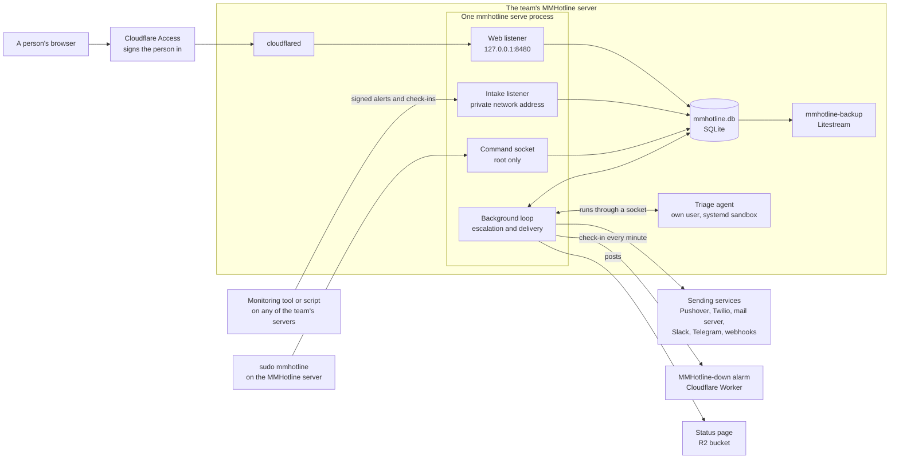

# How MMHotline works

This page explains MMHotline's ideas and parts, for a reader who wants to
understand MMHotline before trusting it with the team's nights or before
changing it. Each part says what it does and, in short, why it is built
that way. The [design](changing-mmhotline/design/README.md) holds the full
rules and reasons; links below go to the section for each part.

MMHotline is on-call software that one team runs on its own server. The
team's tools send it signed **alerts** and **check-ins**. MMHotline works
out who is on call and wakes that person for an **SOS**, the urgent alert
that wakes someone even at night. When the person **claims** the
**incident**, saying "I'm on it", MMHotline stops waking more people. An
unclaimed SOS moves on to the backup, then to everyone available.

## The parts at a glance

| Part | What it does |
| --- | --- |
| [The mmhotline program](#one-go-program) | One Go program: the pages, alert intake, the background loop, and the `mmhotline` command |
| [The database](#one-sqlite-database) | One SQLite file holds the team's whole state |
| [The settings file](#the-settings-file) | One file that root owns sets up the team |
| [The web pages](#the-web-pages-behind-cloudflare-access) | Pages for people, behind Cloudflare Access |
| [Alert intake](#alert-intake) | Receives signed alerts and check-ins on a private address |
| [The background loop](#the-background-loop-escalation-and-delivery) | Moves incidents on and sends notifications |
| [Sending services](#sending-services-and-contact-methods) | Pushover, Twilio, a mail server, Slack, Telegram, and webhooks carry the notifications |
| [The MMHotline-down alarm](#the-mmhotline-down-alarm) | Wakes someone when MMHotline itself is down |
| [The status page](#the-status-page) | Tells the team's customers about an outage |
| [The triage agent](#the-triage-agent-and-its-sandbox) | The team's coding agent looks into alerts first, in a sandbox |
| [The backup](#the-backup) | Litestream copies the database off the server as it changes |

## How an alert becomes an incident and wakes people

Follow one alert. The nightly backup script on `web1` fails and sends an
SOS with `sender_alert_id` `backup-2026-11-15` and `sender_incident_key`
`nightly-backup`.

1. **The script signs and sends the alert** to the intake URL, such as
   `http://10.20.0.1:8484/alert-intake/backup_script`, with a signature
   made from the source's signing secret
   ([Alert requests](reference/alert-requests.md)).
2. **MMHotline checks the request:** the source exists and is active, the
   signature is right, the clock is within 5 minutes, the body follows the
   rules, and the alert is not a repeat. A repeat with the same
   `sender_alert_id` gets the first answer again and changes nothing.
3. **In one database transaction,** MMHotline saves the alert, opens an
   incident (or joins the one still open with the key `nightly-backup`),
   works out who is on call, and queues the notifications. If any part
   fails, nothing is saved, and the script gets `503` and tries again.
4. **MMHotline answers `200`** with a signed receipt. The script now knows
   the alert is safe. Reason for answering only after saving: a `200` must
   mean the alert survives a crash a moment later.
5. **The background loop sends the notifications.** Carlos Example is on
   call. His Pushover notification sounds as an emergency, and his
   automated voice call rings; his email gets the SOS once. The SOS
   repeats every minute.
6. **Carlos claims the incident** on its page, in Pushover, or in Slack or
   Telegram. MMHotline cancels the waiting repeats and wakes nobody else.
7. **If nobody claims in time,** the time to claim runs out
   (`on_call_schedule.escalate_if_unclaimed_after_minutes`), and MMHotline
   wakes the backup, then everyone available. The team gets a Warning that
   says so.
8. **The problem ends.** Carlos resolves the incident, or the script sends
   `resolved-sos` with the key `nightly-backup`. MMHotline stops all
   waking and sends a "Resolved SOS" message to the contact methods it
   told about the incident.

When the triage agent is set up, the SOS first waits a few minutes for the
agent, and step 5 starts when the wait ends, unless someone claims or
resolves the incident first.

`info` and `warn` alerts take steps 1 to 4 and then go to every contact
method subscribed to them. They open no incident and wake nobody.
[Severities and incident states](reference/severities-and-incident-states.md)
lists what each severity does and every state and step.

Three things are separate facts, and MMHotline never treats one as
another: MMHotline accepted the alert; a sending service accepted a
message; a person claimed the incident. Answering a phone call is not a
claim.

## One Go program

`/usr/local/bin/mmhotline` is the whole application. `mmhotline serve`,
run by systemd as `mmhotline.service` under the `mmhotline` user, serves
the pages, receives alerts, and runs the background loop, in one process.
The same program is the `mmhotline` command that people and coding agents
run ([The mmhotline command](reference/mmhotline-command.md)).

- **Why one program:** there is nothing else to deploy, upgrade, or keep
  running. An upgrade is a new file and a restart.
- **Why Go, with no C:** the program is one static file built with
  `CGO_ENABLED=0`, so it runs on any common Linux without installing a
  runtime.
- **The web pages are server-rendered HTML** with small pieces of
  JavaScript. Every action calls the same application operation as the
  `mmhotline` command and the background loop, so there is one place where
  each rule lives.

The command reaches the running service through a Unix socket,
`/run/mmhotline/command.sock`, which has mode 0600 from the start; the service replaces a stale socket file. The service asks the kernel who connected
and admits only root. Reason: a check of the socket file's owner alone
would also admit the `mmhotline` user. A command acts as an administrator,
in the name of the person in `SUDO_USER`.

## One SQLite database

Everything the team's MMHotline knows is in one SQLite file,
`/var/lib/mmhotline/mmhotline.db`: people, schedules, contact methods,
alert sources and their secrets, alerts, incidents with their history, the
queue of notifications and every attempt, and the sending services' setup.

- **Why SQLite:** one file is easy to copy, back up, and restore, and one
  team's alerts are far within what SQLite handles. There is no database
  server to run.
- Every change is one transaction, so a crash leaves either the whole
  change or none of it. SQLite runs with write-ahead logging and full
  synchronization.
- An upgrade keeps every row. A new version adds tables and columns; it
  never renames or removes anything
  ([database format and upgrades](changing-mmhotline/design/operation.md#database-format-and-upgrades)).
- The database is not encrypted at rest. Protect the server, the database
  files, and the backup like the secrets they hold
  ([where secrets live](#where-secrets-live)).

Some facts live only in the process's memory and are rebuilt at start:
the latest check-in times, the counts of refused requests, and Cloudflare
Access's public keys
([what serve keeps in memory](changing-mmhotline/design/operation.md#what-mmhotline-serve-keeps-in-memory-and-rebuilds-at-start)).

## The settings file

`/etc/mmhotline/mmhotline_settings.yml`, owned by root, sets up the team:
its name and addresses, the people, the schedule, the alert sources, the
sending services, the triage agent, the MMHotline-down alarm, and the
status page. Pages show these settings read-only. What a person does for
themselves stays on the pages: contact methods, availability, taking
on-call, claims, and approvals.

- **Why one file:** the team's systems repository and vault are the record.
  A change of who is on call is a commit someone reviewed, and a new server
  is the file plus a restore
  ([why one file](changing-mmhotline/design/settings-file.md#why-one-file)).
- **The file applies in parts,** such as `people`, `alert_sources`, or
  `sending_services.pushover`. Each part is checked, tested against its
  outside service when it has one, and written on its own. A part that
  fails keeps its earlier setting, and the other parts still apply.
- **An unchanged part is not written again.** MMHotline keeps a fingerprint
  of each part's value and skips a part whose value matches what is
  applied, unless it failed last time. So changing one key never re-runs
  every outside test.
- `sudo mmhotline settings apply` asks the running service to read the
  file at the path it was started with, so it applies exactly what it would
  read at its next start.

[Change the settings](how-to/change-the-settings.md) does this step by
step; [The settings file](reference/settings-file.md) lists every key.

## The web pages behind Cloudflare Access

People open MMHotline at the team's web URL, such as
`https://ops.example.com`.

1. Cloudflare Access asks the person to sign in, by the team's rules.
2. Access passes the request, with a token Cloudflare signed, through a
   tunnel that `cloudflared` opened from the MMHotline server.
3. `cloudflared` hands the request to the web listener on
   `127.0.0.1:8480`. The listener reads the `Cf-Access-Jwt-Assertion`
   header and checks the token's RS256 signature against the team's public
   keys, which it fetches from Cloudflare and keeps. Then it checks the
   token's issuer, audience tag, expiry, and not-before time, and names the
   person by the token's sign-in email address.

- **Why Cloudflare Access:** the server accepts no web connection from the
  internet at all, and the team uses the sign-in it already has. MMHotline
  stores no passwords.
- **A person must be in the settings file's `people`.** A signed-in
  stranger gets "not a member".
- **During a Cloudflare outage,** root makes a one-time sign-in link with
  `sudo mmhotline people create-sign-in-link`, and the person opens it
  through an SSH forward to the web listener. The link works once within
  10 minutes; its sign-in lasts 12 hours. The database keeps only hashes of
  links and sign-ins, so a copy of the database signs nobody in
  ([Sign in during a Cloudflare outage](how-to/sign-in-during-a-cloudflare-outage.md)).
- Every change a browser makes needs a `POST`, a matching CSRF cookie and
  form token, and the Go standard library's cross-origin protection,
  because the browser would otherwise send the person's Access sign-in
  with a form from another site. The CSRF cookie lasts 30 days.
- **Cookies** use `HttpOnly`, `SameSite=Strict`, and path `/`. Through
  Cloudflare, the sign-in and CSRF cookies also carry the `__Host-` prefix
  and `Secure`. On a loopback address they have neither, because WebKit
  keeps no `Secure` cookie on `http://localhost`.
- **Security headers** turn off caching and restrict scripts, framing, and
  referrer disclosure.
- **Removing a person** keeps the person's row in the database, marked with
  `removed_at`, so old history still shows the name. It cancels the
  person's queued deliveries and deletes the person's sign-in links and
  sign-ins. A person who joins again gets a new member ID. MMHotline
  refuses a removal that would leave no administrator.

[Put MMHotline behind Cloudflare Access](how-to/put-mmhotline-behind-cloudflare-access.md)
sets this up.

## Alert intake

Tools send to a second listener, the **alert intake address**, set by
`alert_intake_listen_address`, such as `http://10.20.0.1:8484` on a
WireGuard network. It serves only two URLs: one for alerts and one for
check-ins.

- **Why a separate address:** Cloudflare Access refuses any request
  without a person's sign-in, so a tool could never reach the web URL.
- **Why plain HTTP is enough:** each request carries an HMAC signature from
  the source's signing secret, and each answer that matters carries a
  signed receipt. Nobody on the network can forge an alert or fake
  MMHotline's answer.
- **Why the secrets come from the team's vault,** not from MMHotline: the
  monitoring tool on every server signs with the same secret, so both read
  it from the vault.
- **A refused SOS still wakes someone.** When MMHotline must refuse a
  correctly signed SOS, it opens an SOS of its own about the refusal.
- **Limits stop a broken tool from flooding the team.** Only the rate
  limits of 120 alerts a minute for each source and 1,000 new Warning and
  Info alerts an hour for the installation exempt an SOS. MMHotline does
  refuse an SOS (HTTP status 429) when the
  installation has 1,000 unresolved SOS incidents, when the pending
  notification deliveries are full, or when the alert source already has 250
  SOS notifications waiting to be sent. Then it opens an SOS of its own
  about the refusal.
- **Signatures.** MMHotline compares signatures in constant time. The
  answers 401, 413, and 503 are never signed.

### Check-ins

A tool checks in every 30 seconds. When the check-ins stop, MMHotline
sends a Warning and then an SOS, at the times set for the source. Reason: a
monitoring tool that died cannot report its own failure, and a quiet night
should not hide a dead monitor. MMHotline starts watching a source at its
first check-in. A check-in can list servers in maintenance; the sender's
own server in that list counts as planned downtime for the source.

MMHotline's own SOS and Warning about the silence use the incident key
`check-ins:` followed by the alert source ID, so check-ins that return
resolve an unclaimed SOS.

MMHotline keeps check-in times in memory and writes the database only when
something changes, so a check-in every 30 seconds costs nothing. After a
restart, a source that was heard from recently gets its full Warning and
SOS times again; a source already marked silent keeps its recorded times.

[Connect a tool that sends alerts](how-to/connect-a-tool-that-sends-alerts.md)
sets up a tool; [Alert requests](reference/alert-requests.md) lists the
format.

## The background loop: escalation and delivery

About once a second, the background loop checks whether the team has work:
a deadline came, the database changed, or a check-in is overdue. Then it
moves incidents to their next step, sends due repeats, alerts about
missing check-ins, and makes one delivery attempt. It also visits every
10 minutes in any case.

Each notification is a row in the database's delivery queue before
anything is sent:

1. The loop reserves one delivery and checks again that it may still go:
   the contact method is unchanged, the person is still the one to wake,
   and the incident is still unclaimed.
2. It sends the request to the sending service, outside any transaction.
3. It records what the service answered.

- **A duplicate is better than a dropped alert.** If MMHotline stops in
  the middle of step 2, it cannot know whether the message went out. It
  marks the attempt "outcome unknown" and sends again where that is safe,
  so a person may get a message twice but never misses one. A Pushover
  emergency that may already ring is not sent again
  ([recover current work](changing-mmhotline/design/operation.md#recover-current-work)).
- **When the outcome becomes unknown:** a reservation that nobody finished
  expires after 30 seconds, or 45 seconds for email, and the attempt is
  then marked "outcome unknown". The first pass of the loop after start
  marks the reservations of the earlier process at once.
- **Email attempts of one delivery share a Message-ID,** made from the
  delivery ID, so a mail client can show a repeat as the same message.
- **After a restart,** MMHotline reads the saved state and continues. An
  incident whose time to claim ran out during the restart moves on one
  step, with a full new time to claim. Missed repeats become one repeat,
  not a burst.
- **A changed contact method cancels** the old queued message rather than
  sending it to the new address.

## Sending services and contact methods

A **contact method** is one address that a person or the team receives
notifications at. Its **contact method type** says how: `email`,
`automated_voice_call`, `pushover_notification`, `slack_message`,
`telegram_message`, or `outgoing_webhook`. Every type except the webhook
goes through a **sending service**: a mail server, Twilio, Pushover, Slack,
or Telegram, with the team's own account.

- **Why the team's own accounts:** MMHotline runs no hosted service, and
  the team's alerts go only to services the team chose.
- **Only two types wake a sleeping person:** a Pushover notification and an
  automated voice call that get SOS alerts. Team mute stops exactly these
  two.
- **One call is about every waiting incident,** and a number gets one call
  at a time. After 30 minutes of calling, answered calls slow to one every
  5 minutes, so a voicemail box does not fill up.
- **Claiming from the notification** (a Pushover acknowledgement, or a
  button in Slack or Telegram) calls the same claim operation as the page.
- MMHotline reaches Telegram and Slack by connecting out to them, so the
  server needs no address open to the internet for them.
- Outgoing webhooks go only to public internet addresses, checked at the
  moment of connecting.

Each type is one Go file implementing one interface, so the queue and the
escalation rules never test for a type by name
([notifications](changing-mmhotline/design/notifications.md)).
[Connect a sending service](how-to/connect-a-sending-service.md) sets them
up.

## The MMHotline-down alarm

MMHotline cannot wake anyone when its own server is down. The optional
MMHotline-down alarm is a small program, a Cloudflare Worker, in the team's
own Cloudflare account.

1. Every minute, MMHotline checks in with the Worker and hands it ready-made
   requests: the Pushover emergencies and automated voice calls for the
   person on call and the backup, each with a delay.
2. When the check-ins stop, the Worker sends each request when its delay
   has passed.
3. When MMHotline comes back, the Worker's answer lists what it sent, and
   MMHotline sends the all-clear.

- **Why outside the server:** it must keep working when the server, its
  location, or its network is gone.
- **Why ready-made requests:** the Worker needs no schedule, no contact
  methods, and no logic of its own; MMHotline's normal code builds the
  messages. A change of who is on call reaches the Worker within a minute.
- The Worker needs no domain, and Cloudflare's free plan is enough.

[Set up the MMHotline-down alarm](how-to/set-up-the-mmhotline-down-alarm.md)
sets it up; the
[design](changing-mmhotline/design/mmhotline-down-alarm-and-status-page.md#the-mmhotline-down-alarm)
gives the details.

## The status page

The optional status page tells the team's customers that the team knows
about a problem, what it is doing, and when it is over. It is two files,
`status.json` and `index.html`, in an R2 bucket in the team's Cloudflare
account, served at the team's host name.

- **Why files in a bucket:** the page stays up when the MMHotline server is
  down, and a responder can post from a laptop with the same `mmhotline`
  program and an R2 key limited to that one bucket.
- Two posts at once never overwrite each other: each write is conditional
  on the version it read.

[Publish a status page](how-to/publish-a-status-page.md) and
[Post to the status page](how-to/post-to-the-status-page.md) cover it.

## The triage agent and its sandbox

The optional triage agent is the team's own coding agent, Claude Code or
Codex. MMHotline gives it the Warning and SOS alerts first, in a **triage
session**, so it can find and often fix the cause before anyone is woken.
An SOS waits a few minutes for it; then MMHotline wakes the person on call
as usual. A person can press **Take over from the agent** at any time.

The agent runs inside a fence:

- It runs as its own Unix user, `mmhotline-triage-agent`, with no sudo, in
  a systemd sandbox started fresh for each run through a socket. It cannot
  read MMHotline's database, settings file, or sending service tokens.
- It has no network of its own. Every connection from MMHotline's server
  goes through MMHotline's logging proxy, which allows only the hosts the
  settings allow and records every attempt.
- It reads the servers over SSH, as the user `triage`, but holds no key
  that changes them. A command it runs there can open connections from
  that server, which the proxy does not see. To
  change something, it asks MMHotline to run a playbook from the team's
  systems repository with `mmx`. The settings file's rules decide, per
  inventory and kind of action, whether that playbook runs at once, after
  a warning, or only after a person approves.
- MMX runs only commits signed by a key the team trusts, or commits a
  person or, when the team allows it, the triage agent approved. A team
  whose systems repository is on its own server can trust every commit
  there instead (`triage_agent.trusted_commits`).
- A second agent, the review agent, can check each playbook first, as its
  own user, `mmhotline-review-agent`.

**Why a sandbox and a proxy rather than trust:** a coding agent can be
misled by what it reads on a server. The fence makes sure a misled agent
cannot change a server, read a secret, or widen its own rights.

Without the triage agent, nothing in this section happens, and MMHotline is
plain on-call software.
[Set up the triage agent](how-to/set-up-the-triage-agent.md) and
[Decide what the triage agent may do](how-to/decide-what-the-triage-agent-may-do.md)
set it up; the [triage agent design](changing-mmhotline/design/triage-agent.md)
holds the fence's details.

## Other programs MMHotline runs

MMHotline runs the team's code in only four places, each fenced:

| What | How it runs |
| --- | --- |
| Custom schedule code | A Starlark function, `on_call(at)`, in a short-lived child process with no clock, files, network, or randomness, and on Linux a seccomp filter. One run works out who is on call for every quarter hour of the next 14 days, and MMHotline stores the result, so an SOS never waits for the code ([Write a custom schedule](how-to/write-a-custom-schedule.md)) |
| The triage agent and the review agent | In their systemd sandboxes, above |
| `mmx` | For the agent's playbooks, as the `mmhotline` user, with only `HOME` and `PATH` in its environment |
| The fleet view command | For the dashboard's **Servers** part, below |

### The fleet view command

The dashboard can show the monitoring tool's servers. The command that
prints them, the settings file's `fleet_view_command`, often needs root.
MMHotline runs as its own user and cannot gain root. So MMHotline only asks
systemd for a run, through `/run/mmhotline-fleet-view.sock`, which only the
`mmhotline` user may open; systemd runs the command as root in a separate
restricted unit, with a read-only file system, no network but local
sockets, only `PATH` in its environment, no shell, and a 20-second limit.
Only root can set the command, because only root can change the settings
file. One read serves every viewer for 10 seconds
([the fleet view socket](changing-mmhotline/design/operation.md#the-fleet-view-socket)).

## The backup

The optional backup is Litestream, a separate program that copies each
database change to an S3-compatible bucket within about a second. It runs
as its own service, `mmhotline-backup`, under its own user, and reads its
settings from `/etc/mmhotline/backup.env`.

- **Why a separate program:** Litestream's storage libraries stay out of
  MMHotline, which keeps MMHotline one small static file.
- **Why its own file:** a restore on a new server needs the backup
  settings before MMHotline or the database exists.
- On a new server, `mmhotline install` does not start the backup over an
  empty database while the bucket already holds a backup, so the empty
  database never replaces the team's history.

[Back up and restore the database](how-to/back-up-and-restore-the-database.md)
sets it up.

## Where secrets live

The secrets the team supplies are in the settings file, which only root
and MMHotline's own user can read; a team with a deploy tool keeps them in
its vault. MMHotline copies what it needs into the database.

| Secret | Kept in | What it allows |
| --- | --- | --- |
| An alert source's signing secret | The settings file, the database, the tool's own configuration | Sending alerts and resolutions as that source; nothing else |
| Sending service tokens and the mail server password | The database and its backup | Sending as the team's Pushover, Twilio, Slack, Telegram, or mail account |
| Outgoing webhook bearer tokens | The database and its backup | Calling that webhook |
| The triage and review agents' credentials | The database and its backup; given to each run | Using the coding agent's service. No page or command shows them |
| Sign-in links and sign-ins | Only their SHA-256 hashes, in the database | Nothing: a database copy signs nobody in |
| The MMHotline-down alarm's Cloudflare token | The database and its backup | Editing the account's Workers, limited to Workers Scripts › Edit |
| The MMHotline-down alarm's check-in token | The database, and the Worker's secret in Cloudflare | Replacing the alarm's held messages: whoever holds it can change who the alarm wakes, or make the Worker hold nothing |
| The MMHotline-down alarm's held messages | The Worker's Durable Object storage, in the team's Cloudflare account | Each held request holds the Pushover application token or Twilio API key needed to send it |
| A Telegram start token | The link the person opens; the database holds only its SHA-256 | Connecting one chat to the person who asked for the link, once, within 15 minutes |
| The status page's R2 key | The database and its backup | Writing the status page's bucket |
| The `cloudflared` tunnel credential | `cloudflared`'s own files, outside MMHotline | Connecting a server to the team's tunnel |

No page, output, log, or run step prints a credential. Before MMHotline
shows or keeps an outside service's error, it removes every secret value
of the settings file from the text. Someone with root on the server, or a
copy of the database or its backup, has the team's secrets: protect them
as such. MMHotline does not delete old database rows by itself; database
retention is not automated. [Installed files](reference/installed-files.md) lists each file,
its owner, and its mode.

## Where to read the code

The application is the Go package `internal/app`; `cmd/mmhotline` holds the
command and `install`. One whole path through the code:
`AdmitGeneric` (alert intake) → `admitAlert` → `QueueNotification` →
`RunBackground` → `DispatchOne`, then `ClaimIncident` and
`ReconcileIncidents` for how people and time change what is sent.

| Start here | For |
| --- | --- |
| `internal/app/sources.go`, `ingestion.go` | Alert sources, signatures, validation, repeats, and saving alerts |
| `internal/app/alert_source_check_ins.go`, `alert_source_check_in_tracking.go` | Check-ins and alerts about silence |
| `internal/app/incidents.go` | Incident states, claims, deadlines, and escalation |
| `internal/app/delivery.go`, `contacts.go`, `contact_method_type_*.go` | Routing, the delivery queue, and each contact method type |
| `internal/app/background.go` | The background loop |
| `internal/app/settings_file*.go` | The settings file and its parts |
| `internal/app/triage_*.go`, `internal/triageagent` | The triage agent, its sessions, and its sandbox |
| `internal/downalarm`, `internal/statuspage` | The MMHotline-down alarm's Worker and the status page |

[Changing MMHotline](changing-mmhotline/implementation-rules.md) has the
rules for changing the code, and [testing](changing-mmhotline/testing.md)
how to check a change.
